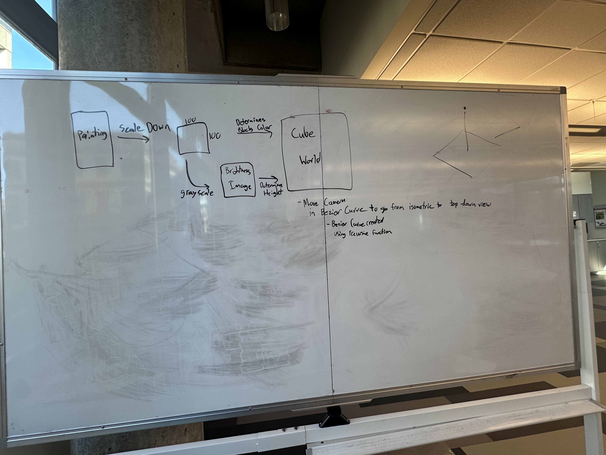

### Computer Graphics Project 2 Documentation
# By Ryan Sippy & Jason Bellerjeau

## Project Overview
[Here](https://sippyr.github.io/ComputerGraphicsCubeWorld/) is the link to the project, and [Here](https://github.com/SippyR/ComputerGraphicsCubeWorld) is the link to the GitHub repository for the project.

The goal of this project was to create a 3D world made out of blocks.  We chose to create a 3D representation of the Mona Lisa painting.  The painting is made out of blocks, the colors of the blocks are determined by the colors of the pixels in the painting, and the height of the blocks is determined by the brightness of the pixels in the painting.  The blocks are arranged in a grid, and the user can see different perspectives by clicking the move camera button.

## Project Design Plan
This is our original design for the project. We would use a python script to scale down the image and generate a grayscale image for the brightness of the blocks.  This would then go into the main program, which would read in the image and generate the blocks based on the colors and brightness of the pixels.  



This main concept was implemented in the final project, but we chose to add a flying block that moved in a bezier curve around the painting.  This block was intended to represent Leonardo da Vinci's flying machine, however we struggled mapping the texture image of the flying machine onto the block, which is why it is a 2x2 of the texture image.  We also added a button to change the camera perspective, which was not in the original design.

## Implementation
Instancing: Instead of drawing 193,000 cubes one by one, the GPU receives the basic cube shape just once and draws every copy in a single command.

Image Data: The script loads the Mona Lisa images onto hidden canvases to read their exact pixels. The color image paints each cube, and the greyscale image determines how tall it is.

```
// Draw an image onto a hidden canvas and return its pixel data:
// a flat list of numbers, 4 per pixel (red, green, blue, alpha),
// going left to right across each row, rows top to bottom.
function getPixels(img) {
  const offscreen = document.createElement('canvas');
  offscreen.width = img.width;
  offscreen.height = img.height;
  const ctx = offscreen.getContext('2d');
  ctx.drawImage(img, 0, 0);
  return ctx.getImageData(0, 0, img.width, img.height).data;
}
```

Shaders: The vertex and fragment shaders are written in GLSL. The vertex shader calculates the position of each cube, and the fragment shader colors each cube based on the image data.

```
const terrainVertexSource = /* glsl */ `
  attribute vec3 aPosition;   // corner position of the cube (model space)
  attribute vec3 aNormal;     // direction the face is pointing

  // Per-INSTANCE attributes: these change once per cube, not per vertex.
  attribute vec2 aOffset;     // where this cube sits on the ground (x, z)
  attribute float aHeight;    // how tall this cube is
  attribute vec3 aColor;      // this cube's color (red, green, blue: 0..1)

  uniform mat4 uView;         // where the camera is and where it looks
  uniform mat4 uProjection;   // perspective: far things look smaller

  varying vec3 vNormal;       // handed to the fragment shader
  varying vec3 vColor;

  void main() {
    // Stretch the cube upward to its height, then slide it to its spot.
    // This does the same job as the old per-cube uModel matrix
    // (translation × scaling), without needing a matrix for every cube.
    vec3 world = vec3(
      aPosition.x + aOffset.x,
      aPosition.y * aHeight,
      aPosition.z + aOffset.y
    );

    // Stretching only along y never changes which way a face points,
    // so the normal can be passed through unchanged.
    vNormal = aNormal;
    vColor = aColor;

    // world -> camera -> screen.
    gl_Position = uProjection * uView * vec4(world, 1.0);
  }
`;
```

Animation: The sky block flies back and forth along a curved 3D path (a Bezier curve). It uses a cosine math function to naturally slow down and turn around at the ends of the path.

Camera: Custom matrix math handles the 3D perspective and targeting. Clicking the button smoothly transitions the camera from a top-down view to a 3D angle over 10 steps.

Textures: The sky block is wrapped in a repeating image. It generates "mipmaps" (smaller versions of the image) so the picture remains smooth and doesn't flicker when it flies far away.

## Future Work
We would first like to fix the texture mapping on the flying block, so that it is not a 2x2 of the image.  We would also like to add more flying blocks, and have them fly in different patterns around the painting.  Finally, we would also like to add more camera perspectives, and have the user be able to control the camera with the mouse.  

## Demo Video
[Computer Graphics Project 2 Demo](https://youtu.be/m7P2xjEKYvQ)
